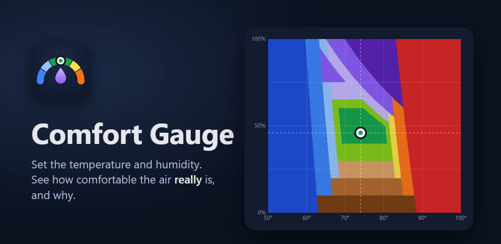

# Comfort Gauge



Comfort Gauge is an Android app. You set an air temperature and a relative humidity, and it tells you how comfortable that air is for most people, and why. It judges two separate axes:

- **Thermal:** the ISO 7730 / ASHRAE 55 PMV-PPD model (Fanger). It uses the best case over 0.5–1.0 clo, 1.1 met and still air.
- **Humidity:** relative humidity bands on the dry side, and dew point on the humid side (ASHRAE 55's 0.012 kg/kg limit is about a 62°F dew point).

The app also shows a 2-D comfort map, a "feels like" gauge, the Heat Index (NWS), Apparent Temperature (BOM), Humidex (Environment Canada) and the dew point. Everything works offline. The app has no permissions, ads or tracking.

- Website and privacy policy: https://kjcornwell.github.io/ComfortCalculator/
- Spec: [`reference/comfort-gauge.html`](reference/comfort-gauge.html), the HTML prototype this app ports exactly

## Build

Requires JDK 21+ and Android SDK 37.

```bash
./gradlew testDebugUnitTest           # model + acceptance tests
./gradlew assembleDebug
./gradlew connectedDebugAndroidTest   # Compose UI test (emulator)
./gradlew bundleRelease               # needs keystore.properties (not in git)
```

Kotlin · Jetpack Compose · Material 3 · DataStore. minSdk 26.
